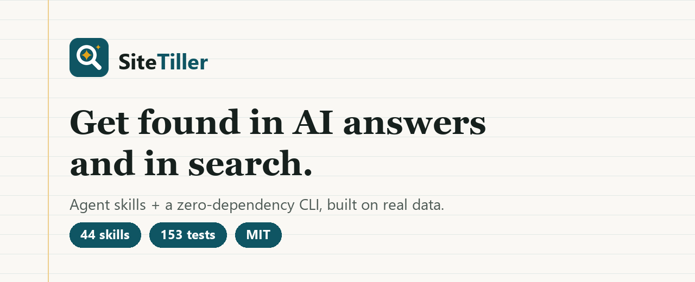

<p align="center"><a href="https://sitetiller.com/?utm_source=github&utm_medium=readme"></a></p>

# SiteTiller AI Visibility & SEO Skills

**44 agent skills + a zero-dependency Node CLI (`npx sitetiller`)** for checking how ChatGPT, Claude, Perplexity, Google AI Overviews, and classic search engines actually crawl, read, and cite your site.

Every skill is grounded in vendor documentation (dated in `references/sources.md`) and backed by **153 offline tests**. No hype, no promised rankings — only measurable checks and reversible changes.

---

## Try It in 10 Seconds (Zero Dependencies)

```bash
npx sitetiller agent https://sitetiller.com      # can AI assistants & agents read your server HTML?
npx sitetiller crawlers https://sitetiller.com   # which AI bots robots.txt allows or blocks (and which rule wins)
npx sitetiller cite https://sitetiller.com/check # section-by-section citability: answer-first, numbers, sources
npx sitetiller crawl https://sitetiller.com      # polite site crawl with per-page findings & score arithmetic
npx sitetiller logs access.log                   # real GPTBot/OAI-SearchBot/PerplexityBot visits (IP-verified)
npx sitetiller engines example.com https://example.com/ --start 2026-10-01 --end 2026-11-05  # Google vs Bing gaps
npx sitetiller version snapshot https://example.com/page --label "v2"                        # measure & roll back
```

**Real output (`npx sitetiller agent https://sitetiller.com`):**

```json
{
  "url": "https://sitetiller.com/",
  "status": 200,
  "words": 2677,
  "scripts": 2,
  "appShell": false,
  "checks": [
    { "check": "Main text is in the server HTML (150+ words)", "pass": true, "detail": "2677 words without running JavaScript" },
    { "check": "One H1 and a heading outline", "pass": true, "detail": "1 H1, 28 H2-H4" },
    { "check": "Landmarks: <main> and <nav>", "pass": true },
    { "check": "Form fields have labels", "pass": true, "detail": "5/5" }
  ]
}
```

More unedited `--json` outputs live in [`examples/`](examples/).

---

## Install

**Claude Code (plugin):**
```bash
/plugin marketplace add sitetiller/ai-visibility-skills
/plugin install sitetiller-ai-visibility@sitetiller
```

**Antigravity / Gemini CLI / Codex / Cursor:**
Copy `skills/*` into your agent's skills directory (for example `.agents/skills/` or `.gemini/skills/`) and keep `AGENTS.md` at the repo root.

**CLI only (Node 18.17+, zero dependencies):**
```bash
npx sitetiller help
```
Package: [npmjs.com/package/sitetiller](https://www.npmjs.com/package/sitetiller)

---

## What Makes It Different

1. **Verified AI Bot Visits (`logs`):** Separates genuine `GPTBot`, `OAI-SearchBot`, `PerplexityBot`, `Googlebot`, and `Bingbot` hits from spoofed user-agents using each vendor's published IP ranges, and counts AI-referred traffic.
2. **Measured & Reversible Changes (`version`):** Captures search-engine snapshots, diffs, drift alerts, and difference-in-differences measurement with bootstrap intervals against control pages. The WordPress/Ghost/static publisher keeps an ownership ledger and **refuses to edit pages it did not create**.
3. **Google + Bing Side-by-Side (`engines`):** Compares Google Search Console and Bing Webmaster Tools query-by-query to surface gaps where only one engine ranks you.

**Also included across the 44 skills:**
- **AI & Agent Readiness:** `robots.txt` AI crawler audit, `llms.txt` & `Content-Signal` checks, server-rendered text & accessible names, section-level citability, and BYO-key AI answer/citation tracking.
- **Technical & Performance:** Polite site crawler, CrUX Core Web Vitals history with LCP subparts, multi-page Lighthouse, IndexNow, sitemap/canonical/hreflang/redirect audits, and Google-required JSON-LD lint (never invents ratings).
- **Content & pSEO Quality Gate:** Thin-page detection, near-duplicate checks after stripping template boilerplate, content decay, cannibalization, internal link graphs, and Search Console + Bing backlinks (no paid index required; optional DataForSEO/Ahrefs refused without `--yes`).
- **Verticals:** Local SEO (NAP consistency) and e-commerce SEO.

---

## How It Compares (Feature Focus)

| Capability | `sitetiller/ai-visibility-skills` | Typical SEO Skill Packs |
| :--- | :---: | :---: |
| Zero-dependency runnable CLI (`npx`) | **✓** | — |
| IP-verified AI bot log analysis (`GPTBot`, `PerplexityBot`, etc.) | **✓** | — |
| Measured changes + DiD rollback + ownership ledger | **✓** | — |
| Google Search Console + Bing side-by-side gap CLI | **✓** | Partial |
| Agent-readiness & section-level citability scoring | **✓** | — |
| Automated offline test suite | **153 tests** | 0–150 |
| License | **MIT** | MIT / Apache-2.0 |

*(Run `node bench/bench.mjs` to regenerate the live GitHub repository inventory table.)*

---

## Want It Hosted & Automated Every Week?

These 44 skills and the CLI are MIT-licensed and stay free. [SiteTiller](https://sitetiller.com/?utm_source=github&utm_medium=readme) is the hosted autopilot: it connects to Search Console and Bing, builds new buyer-intent pages and calculators, publishes without touching existing pages, tracks AI citations, and rolls back any version that loses clicks.

Try the free 30-second check first (no signup): **[sitetiller.com/check](https://sitetiller.com/check?utm_source=github&utm_medium=readme)**

---

## All 44 Skills (`AGENTS.md` for full index)

- **Data & Planning:** `setup`, `gsc-bing`, `ga4-ai`, `quick-wins`, `weekly-check`, `seo-report`, `seo-plan`
- **Technical:** `tech-audit`, `site-architecture`, `sitemaps`, `indexing`, `redirects-migration`, `canonicals`, `hreflang`, `core-web-vitals`, `images`
- **Content:** `onpage`, `titles-meta`, `content-brief`, `content-quality`, `sxo`, `topic-clusters`, `cannibalization`, `content-decay`, `internal-links`, `schema`, `comparison-pages`, `competitors`
- **Links:** `backlinks`
- **AI Visibility:** `ai-crawlers`, `ai-logs`, `citability`, `ai-tracker`, `llms-txt`, `ai-citations`, `agent-ready`
- **Measurement & Publishing:** `measure-rollback`, `pseo-quality-gate`, `wordpress-publish`, `ghost-publish`, `static-site-publish`, `platforms`
- **Verticals:** `local-seo`, `ecommerce-seo`

## Principles
- **Read-only by default:** Public checks fetch one page at a time; connectors use read-only scopes.
- **Own pages only:** Publishing and rollback never modify pages the tool did not create.
- **Sourced:** Thresholds and vendor rules link to dated primary docs in `references/sources.md`.
- **Secrets stay local:** Environment variables or gitignored `.env`; never logged or committed.

## Develop
```bash
node --test tests/*.test.mjs        # 153 offline tests
node scripts/validate-skills.mjs    # validates skill format, CLI commands & sources
node bench/bench.mjs                # benchmark script
```

MIT licensed. See `THIRD_PARTY_NOTICES.md`. Built by [SiteTiller](https://sitetiller.com).
